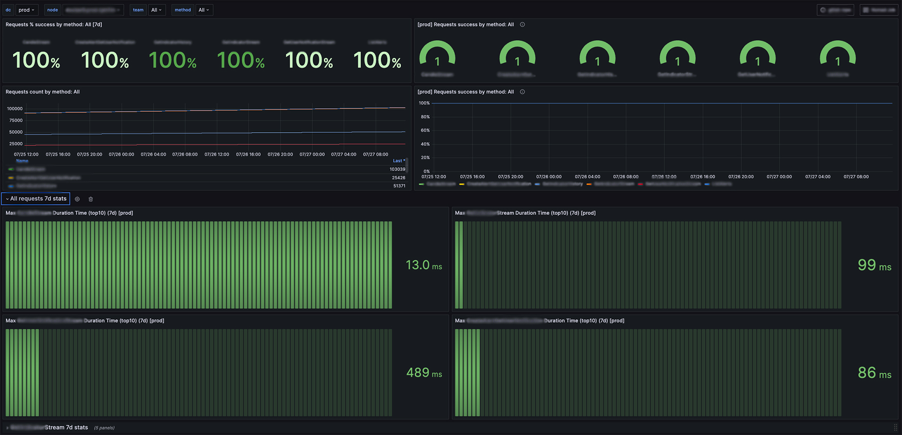

# grpc-streams-checker

Synthetic monitoring for gRPC **server-side streams** — opens every stream like a real client,
demands real frames with valid payloads, and exports rich Prometheus metrics you can page on.

[](https://github.com/youngpabl0/grpc-streams-checker/actions)
[](LICENSE)
[](package.json)

## The problem

Uptime checks are solved for request/response APIs: hit the endpoint, read the status code, done.
Server-side streaming RPCs break that model. A stream is a channel the server holds open and pushes
messages into over time — so **the socket can be up, the handshake can succeed, the health endpoint
can be green, and yet no data is flowing.**

It gets worse in real production topologies, where a stream crosses several hops before a browser or
service consumes it:

```
client ──▶ LB ──▶ Envoy (grpc-web / HTTP/2) ──▶ backend service ──▶ upstream feed
```

Every hop is a place where the stream can silently die while everything still looks healthy:

- an **idle-timeout on the LB or proxy** quietly kills long-lived connections;
- **Envoy / grpc-web translation** can buffer or drop frames while the TCP session stays up;
- the backend keeps the stream open but its **upstream feed went quiet** — it has nothing to push;
- the stream produces frames, but they're **garbage** (empty payloads, missing fields) after a bad deploy.

None of these are visible to an HTTP 200 probe or a gRPC health check. The only probe that answers
"is this stream actually serving valid data?" is a client that **opens the stream, reads several
frames, and checks what's inside them.** That's exactly what this checker is.

## What a check does

For every stream in your config, on every run, the checker:

1. **loads the `.proto` at runtime** (no codegen, no stale stubs — add a stream by pointing at a file);
   or, with `"reflection": true`, **fetches the schema from the server** through gRPC server reflection;
2. **opens the server-side streaming RPC** as a real client (TLS or plaintext, optional auth metadata);
3. **collects `minFrames` frames** (default 1; set 3–5 to verify *sustained* flow, not just a first burp)
   within the time budget, measuring time-to-first-frame and the largest inter-frame gap;
4. **validates every frame's payload** against your rules — required fields, exact matches, regexes;
   with a `freshness` rule it also checks that the timestamp inside each frame is recent;
5. **cancels the stream** and writes the outcome to Prometheus metrics.

One bad stream never fails the run; every failure mode gets its own result label:
`ok` · `timeout` · `insufficient_frames` · `validation_failed` · `stale` · `error` (with the gRPC status code).

## What it looks like in production

A Grafana dashboard built on the checker's metrics, watching six production streaming methods across
a week — per-method success rate, request counts, and top-10 stream duration:



## Quick start (60 seconds, no infrastructure)

```bash
git clone https://github.com/youngpabl0/grpc-streams-checker.git
cd grpc-streams-checker && npm ci

# terminal 1 — demo gRPC server with a PriceStream
node examples/demo-server.js

# terminal 2 — run the checker against it
cp streams.example.json streams.json
node src/index.js --once
#  → {"stream":"price_stream","result":"ok","frames":3,"firstFrameMs":223,...}
```

Now break it and watch the checker notice:

```bash
node examples/demo-server.js --silent    # stream opens, no frames  → result: timeout
node examples/demo-server.js --broken    # frames with empty fields → result: validation_failed
node examples/demo-server.js --slow=2000 # sluggish producer        → max_inter_frame_ms grows
node examples/demo-server.js --stale     # same cached tick forever → result: stale
node examples/demo-server.js --error=UNAVAILABLE # stream fails with a status → result: error
```

`--once` exits non-zero if any stream failed — usable directly as a CI gate or cron probe.

## Demo stack (one command)

The whole picture with Docker only: demo gRPC servers in several states, the checker, Prometheus
with the bundled alert rules, and Grafana with the bundled dashboard already provisioned.

```bash
cd deploy/docker-compose
docker compose up --build
```

| What | URL |
|---|---|
| Grafana dashboard | http://localhost:3000 (opens on the dashboard; anonymous viewer, `admin` / `admin` to edit) |
| Prometheus, alert rules | http://localhost:9090/alerts |
| Checker metrics | http://localhost:4777/metrics |

The stack checks six streams: two healthy, one slow (big inter-frame gaps, the occasional
`insufficient_frames`), one with empty payloads (`validation_failed`), one that opens and never
sends a frame (`timeout`), and one flaky server that cycles through normal, slow, broken, silent
and `UNAVAILABLE` every 3 minutes, so failures and recoveries show up on the graphs. Stop it with
`docker compose down -v`.

The dashboard JSON lives in
[`deploy/grafana/grpc-streams-checker-dashboard.json`](deploy/grafana/grpc-streams-checker-dashboard.json)
and imports into any Grafana as is (Dashboards > New > Import; pick your Prometheus data source in
the variable at the top).

## Configuration

```jsonc
{
  "addr": "localhost:50051",        // default target for all streams
  "dc": "dev",                      // datacenter label on every metric
  "tls": false,                     // TLS on by default; false = plaintext
  "intervalSeconds": 30,            // how often to re-check (daemon mode)
  "firstFrameTimeoutMs": 5000,      // budget for collecting minFrames
  "minFrames": 3,                   // frames to demand per check (sustained flow)
  "protoIncludeDirs": ["protos"],   // resolve `import` statements inside protos

  "auth": {                         // optional; ${VARS} expand from the environment
    "token": "${GRPC_TOKEN}",       // → authorization: Bearer <token>
    "metadata": { "x-tenant": "${TENANT_ID}" }
  },

  "streams": [
    {
      "name": "price_stream",              // metric label + --only key
      "proto": "protos/price.proto",       // path to the .proto file
      "package": "example.v1",
      "service": "PriceService",
      "method": "PriceStream",             // a server-side streaming RPC
      "request": { "symbol": "BTCUSD" },   // request message for the call
      "minFrames": 3,                      // per-stream override
      "timeoutMs": 10000,                  // per-stream override
      "addr": "other-host:443",            // per-stream override
      "tls": true,                         // per-stream override
      "expect": {                          // payload validation, per frame
        "fields": ["symbol", "price", "ts"],      // must exist & be non-empty
        "match": { "symbol": "BTCUSD" }           // exact match…
        // "match": { "symbol": "/^BTC/" }        // …or /regex/
      },
      "freshness": {                       // optional: data must be recent
        "field": "ts",                     // dotted path to the frame's timestamp
        "maxAgeSeconds": 10                // older than this -> result: stale
        // "unit": "ms"                    // only for epoch numbers; guessed if omitted
      }
    }
  ]
}
```

### Data freshness

A stream can stay open, deliver frames on time and pass payload validation while serving data that
stopped changing: a producer that replays its cache, or a backend whose upstream feed froze and
keeps re-sending the last value. A `freshness` rule compares the timestamp inside each frame with
the checker's clock:

```json
"freshness": { "field": "ts", "maxAgeSeconds": 10 }
```

- `field` is a dotted path into the frame (`"ts"`, `"meta.updated_at"`). Accepted values: epoch
  numbers or numeric strings in seconds, milliseconds, microseconds or nanoseconds (the unit is
  guessed from the magnitude, or set `"unit": "s" | "ms" | "us" | "ns"`), RFC 3339 strings
  (`"2026-11-23T10:00:00.123Z"`, `"...+07:00"`) and `google.protobuf.Timestamp` messages.
- A frame older than `maxAgeSeconds` ends the check with `result="stale"` (and `grpc_stream_up` 0).
- A missing or unparsable timestamp ends it with `result="validation_failed"` and
  `rule="invalid_timestamp"`.
- `grpc_stream_data_age_seconds` reports the largest data age seen in the last check, so you can
  graph how far behind a stream is even while it is still under the limit.
- The age is measured against the checker's clock: keep NTP running on both sides and leave a few
  seconds of slack in `maxAgeSeconds`. A timestamp slightly in the future gives a negative age and
  passes.

Try it: `node examples/demo-server.js --stale` keeps sending one cached tick stamped a minute before
the server started; the `price_stream` in `streams.example.json` has a 10-second freshness rule and
reports `stale`. The alert `GrpcStreamDataStale` fires on repeated stale checks.

### Server reflection (no `.proto` files)

If the server exposes the [gRPC server reflection API](https://github.com/grpc/grpc/blob/master/doc/server-reflection.md),
a stream can drop `proto` and ask the server for its schema instead:

```json
{
  "name": "price_stream",
  "reflection": true,
  "package": "example.v1",
  "service": "PriceService",
  "method": "PriceStream",
  "request": { "symbol": "BTCUSD" }
}
```

- The checker asks for the file that declares `package.service`, then for every file it imports,
  over `grpc.reflection.v1`; servers that only implement the older `grpc.reflection.v1alpha` are
  handled by a fallback. Well-known types (`google/protobuf/*.proto`) the server does not serve are
  taken from the bundled copies.
- The reflection call uses the stream's own target, TLS setting and `auth` metadata.
- Descriptors are cached per address (target, TLS on/off, service), so reflection runs once, not on
  every check. After a check that ends in `error` the entry is dropped and the next run asks the
  server again, which picks up a redeployed server with a changed schema.
- If the server has no reflection service the check ends with `result="error"`, `code="UNIMPLEMENTED"`
  and a message naming both API versions it tried; a service the server does not know ends with
  `result="error"` and the service name in the message.
- Set either `proto` or `"reflection": true` on a stream, not both.

Try it against the demo server:

```bash
node examples/demo-server.js --reflection   # PriceService + reflection (v1 and v1alpha)
```

Environment overrides: `CONFIG`, `ADDR`, `DC`, `PORT` (default 4777), `TIMEOUT_MS`,
`INTERVAL_SECONDS`, `MIN_FRAMES`, `LOG_LEVEL`, `LOG_PRETTY=true`.

For auth beyond a bearer token (minted JWTs, AWS SigV4, mTLS) extend the single seam in
[`src/auth.js`](src/auth.js).

## Supplying your `.proto` files

The checker consumes plain `.proto` **source files at runtime**: you never compile stubs. Four
common ways to get them next to the checker:

1. **Copy them in** — drop the files into `protos/` in your deployment and reference
   `"proto": "protos/your_service.proto"`. If your protos `import` shared definitions, list the
   roots in `"protoIncludeDirs"` so imports resolve.
2. **Git submodule / subtree** — if your org keeps a proto monorepo (the usual case), pin it:
   `git submodule add <proto-repo-url> protos`. The checker then always tests against the exact
   contract version you pinned — bump the submodule to test a new contract.
3. **Bake into the image** — in your own Dockerfile layer, `COPY protos/ /app/protos/`, or at
   runtime mount them: `-v $PWD/protos:/app/protos:ro`.
4. **Skip the files**: if the server runs gRPC server reflection, set `"reflection": true` on the
   stream and leave `proto` out (see [Server reflection](#server-reflection-no-proto-files)).

Google well-known types (`google/protobuf/*.proto`) ship with `protobufjs` and resolve
automatically; you only need `protoIncludeDirs` for *your* shared imports.

## Metrics

Served at `:4777/metrics` (`/healthz` for liveness). Labels on every per-stream metric:
`stream`, `method` (the RPC method — powers per-method dashboards), `addr`, `dc`.

Success rate by method — the query behind the dashboard panels above:

```promql
sum by (method) (rate(grpc_stream_check_total{result="ok"}[5m]))
/
sum by (method) (rate(grpc_stream_check_total[5m]))
```

| Metric | Type | Meaning |
|---|---|---|
| `grpc_stream_up` | gauge | 1 = last check passed (frames arrived **and** payloads valid) |
| `grpc_stream_check_total{result}` | counter | checks by outcome: `ok`/`timeout`/`insufficient_frames`/`validation_failed`/`stale`/`error` |
| `grpc_stream_error_total{code}` | counter | failures by gRPC status code (`UNAVAILABLE`, `DEADLINE_EXCEEDED`, …) |
| `grpc_stream_first_frame_ms` | gauge | time to first frame, last check |
| `grpc_stream_first_frame_duration_seconds` | histogram | same, for percentiles over time |
| `grpc_stream_max_inter_frame_ms` | gauge | worst gap between frames within a check — sustained-flow health |
| `grpc_stream_frames_last_check` | gauge | frames received in the last check |
| `grpc_stream_frames_total` | counter | frames received, ever |
| `grpc_stream_validation_fail_total{rule}` | counter | payload failures: `missing_field`/`mismatch`/`empty_frame`/`invalid_timestamp` |
| `grpc_stream_data_age_seconds` | gauge | largest age of the data in the frames of the last check (streams with a `freshness` rule) |
| `grpc_stream_last_success_timestamp_seconds` | gauge | when this stream last fully passed |
| `grpc_stream_last_run_timestamp_seconds` | gauge | when the checker last completed a run |

## Alerting

Ready-made Prometheus rules ship in
[`alerts/grpc-streams-checker.rules.yml`](alerts/grpc-streams-checker.rules.yml): nine alerts with
severities, `for:` windows, and runbook-style descriptions, copy-paste compatible with plain
Prometheus `rule_files:` and with a prometheus-operator `PrometheusRule`. Highlights:

| Alert | Condition | Severity |
|---|---|---|
| `GrpcStreamDown` | `grpc_stream_up == 0` for 2m — no valid data | critical |
| `GrpcStreamFirstFrameSlow` | first frame > 2s for 5m — degrading before dark | warning |
| `GrpcStreamStuttering` | inter-frame gap > 5s — producer not keeping up | warning |
| `GrpcStreamPayloadInvalid` | validation failures — data went bad after a deploy | critical |
| `GrpcStreamDataStale` | checks keep finding frames older than the freshness limit | critical |
| `GrpcStreamErrors` | repeated gRPC errors by status code | warning |
| `GrpcStreamNoRecentSuccess` | nothing fully green in 5m | critical |
| `GrpcStreamsCheckerDead` | the checker itself stopped — silence ≠ health | critical |

## Docker

```bash
docker build -t grpc-streams-checker .
docker run -p 4777:4777 \
  -v "$PWD/streams.json:/app/streams.json:ro" \
  -v "$PWD/protos:/app/protos:ro" \
  -e GRPC_TOKEN \
  grpc-streams-checker
```

## Kubernetes

Ready-made manifests in [`deploy/kubernetes/`](deploy/kubernetes/):

- [`checker.yaml`](deploy/kubernetes/checker.yaml) — ConfigMaps (streams.json + protos), Deployment
  with liveness/readiness probes, conservative resources (`25m/96Mi` requests, `200m/256Mi` limits —
  the checker idles between runs), hardened securityContext (non-root, read-only rootfs, no caps),
  and a Service exposing `/metrics`.
- [`servicemonitor.yaml`](deploy/kubernetes/servicemonitor.yaml) — ServiceMonitor + PrometheusRule
  wrapper for prometheus-operator; the rule groups come from
  [`alerts/grpc-streams-checker.rules.yml`](alerts/grpc-streams-checker.rules.yml).

```bash
kubectl apply -f deploy/kubernetes/checker.yaml
# prometheus-operator users:
kubectl apply -f deploy/kubernetes/servicemonitor.yaml
```

Auth tokens belong in a `Secret` exposed as an env var (`GRPC_TOKEN`) — the config file references
it as `${GRPC_TOKEN}`, so no credentials ever live in the ConfigMap.

## Helm

A chart in [`deploy/helm/grpc-streams-checker/`](deploy/helm/grpc-streams-checker/) renders the same
objects as the plain manifests: ConfigMaps for `streams.json` and the `.proto` files, a Deployment
with probes, the same resources and hardened securityContext, a Service, and optionally a
ServiceMonitor and a PrometheusRule carrying the rules from `alerts/`.

```bash
helm install streams-checker deploy/helm/grpc-streams-checker \
  --namespace monitoring --create-namespace \
  --set image.repository=registry.example.com/grpc-streams-checker \
  -f my-values.yaml
```

Build the image from the repo `Dockerfile` and push it to your registry first. A minimal
`my-values.yaml`:

```yaml
config:                       # rendered as streams.json, same schema as streams.example.json
  addr: my-backend.prod.svc.cluster.local:443
  dc: prod
  streams:
    - name: price_stream
      proto: protos/price.proto
      package: example.v1
      service: PriceService
      method: PriceStream
      request: { symbol: BTCUSD }
      freshness: { field: ts, maxAgeSeconds: 10 }

protos:                       # mounted at /app/protos; --set protos=null if all streams use reflection
  price.proto: |
    syntax = "proto3";
    ...

env:                          # secrets from a Secret, referenced as ${GRPC_TOKEN} in config.auth
  - name: GRPC_TOKEN
    valueFrom:
      secretKeyRef: { name: grpc-streams-checker-auth, key: token }

serviceMonitor:               # prometheus-operator
  enabled: true
  labels: { release: kube-prometheus-stack }
prometheusRule:
  enabled: true
  labels: { release: kube-prometheus-stack }
```

Other values: `existingConfigMap` / `existingProtosConfigMap` to bring your own ConfigMaps,
`prometheusRule.additionalGroups` to append your own rule groups, `scrapeAnnotations` for
annotation-based scraping, plus the usual `resources`, `nodeSelector`, `tolerations`, `affinity`,
`podAnnotations`, `imagePullSecrets`. Pods roll automatically when the config or the protos change.
See [`values.yaml`](deploy/helm/grpc-streams-checker/values.yaml) for every key.

## The pattern generalizes

The same "open it, demand frames, validate payloads" approach works for any long-lived push
transport — WebSocket, SSE, message-queue consumers. The value is turning *"is data actually
flowing, and is it valid?"* into labelled metrics you page yourself about, instead of something a
customer reports.

## Built on

This tool is a thin, opinionated layer over excellent open-source work:

- [`@grpc/grpc-js`](https://github.com/grpc/grpc-node) — the pure-JS gRPC client that carries every check.
- [`@grpc/proto-loader`](https://github.com/grpc/grpc-node/tree/master/packages/proto-loader) — runtime
  `.proto` loading (via [`protobufjs`](https://github.com/protobufjs/protobuf.js)); the reason there is no codegen step.
- [`prom-client`](https://github.com/siimon/prom-client) — Prometheus metrics for Node.
- [`pino`](https://github.com/pinojs/pino) — fast structured JSON logging.
- [`express`](https://github.com/expressjs/express) — serves `/metrics` and `/healthz`.

## License

[Apache License 2.0](LICENSE) — free to use, modify, and distribute; keep the copyright and
`NOTICE`. Copyright 2026 Daniil Romashov.
